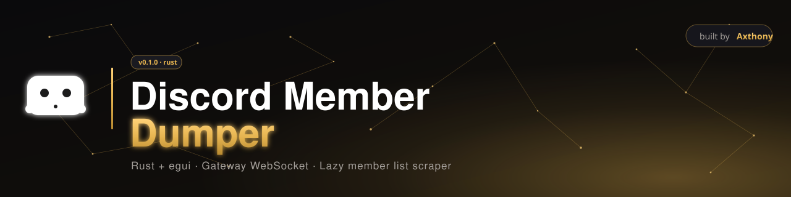
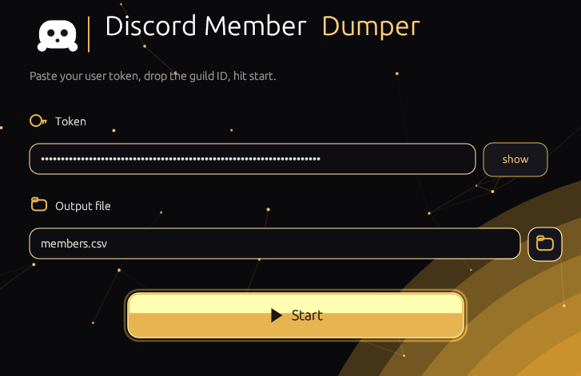
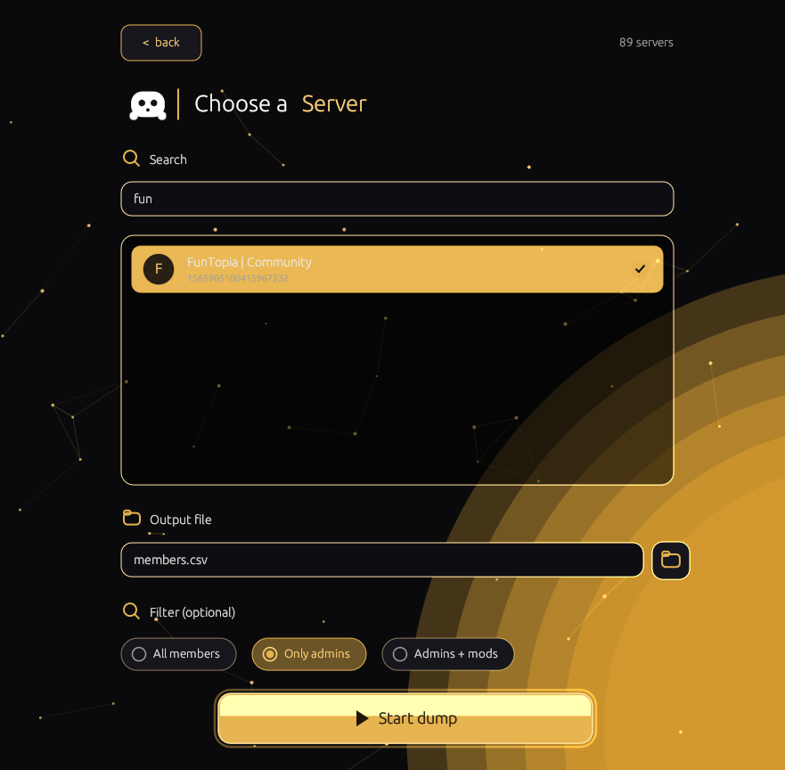
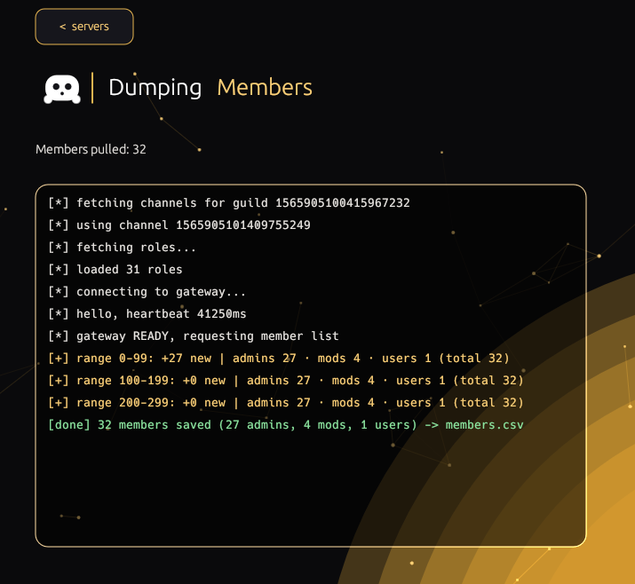

<p align="center">
  
</p>

<p align="center">
  
  
  
  
</p>

<p align="center">
  <b>A native Windows GUI, written in Rust, for exporting the full member roster of any Discord guild you can access — with built-in role and permission classification.</b>
</p>

---

## Overview

Discord Member Dumper connects to the Discord Gateway as a stable web client and streams the lazy member list the official sidebar uses. It works with a plain user token and only requires `VIEW_CHANNEL` on one text channel of the target guild — no bot, no elevated permission, no `GUILD_MEMBERS` intent.

Each member is cross-referenced against the guild's role map so the output CSV distinguishes administrators, moderators and regular users at a glance, and an optional filter restricts the dump to only the categories you care about.

## Features

- **Native Windows binary** written in pure Rust — single `.exe`, no runtime dependencies.
- **Polished UI** built with [`eframe`/`egui`](https://github.com/emilk/egui): gold-on-black palette, animated constellation background, custom drawn icons and buttons, smooth hover and click interpolation.
- **Three-screen flow** — paste token → pick guild from your own server list → watch the dump stream in real time.
- **Password-masked token input** with show / hide toggle.
- **Server picker** fetched from `/users/@me/guilds` with live search filter and selection state.
- **Native file dialog** (Windows Save As) for the output path.
- **Role-aware classification**: every member is tagged `is_admin` / `is_mod` based on their resolved permission bitfield, including inherited `@everyone` permissions.
- **Optional filter**: dump every member, admins only, or admins + mods.
- **Gateway WebSocket scraper** via `tokio-tungstenite` — full Hello / Identify / Ready / Heartbeat / Op 14 Lazy Guild Subscribe handshake, sequence tracking, graceful reconnect and invalid-session reporting.
- **Live progress log** colour-coded by severity, deduplicated by user ID.
- **Fully asynchronous**: the UI never blocks while the gateway is working.

## Screenshots

<p align="center">
  
  
</p>
<p align="center">
  
</p>

## Installation

**Requirements:** [Rust toolchain](https://rustup.rs) 1.75 or newer, Windows 10 or 11.

```powershell
git clone https://github.com/AxthonyV/discord-member-dumper.git
cd discord-member-dumper
cargo build --release
.\target\release\discord_dumper_gui.exe
```

Or use the bundled helper, which builds and launches in one step:

```powershell
.\build.ps1
```

The first release build compiles every dependency; expect one to three minutes depending on your machine. Incremental rebuilds take seconds.

## Usage

1. Launch the binary.
2. Paste your Discord user token into the **Token** field. Use the `show` button to verify it as you type. See [Finding your token](#finding-your-token) below.
3. (Optional) Pick a destination CSV via the folder icon — defaults to `members.csv` next to the binary.
4. Press **Start**. The app loads your full guild list from `/users/@me/guilds`.
5. Choose a server from the list. The search box filters by name in real time; the guild ID is shown as a subtitle under each entry.
6. (Optional) Pick a **Filter** to restrict the export:
   - **All members** — every member, no filter.
   - **Only admins** — members whose combined permissions include the `ADMINISTRATOR` bit.
   - **Admins + mods** — the above plus anyone holding `KICK`, `BAN`, `MANAGE_CHANNELS`, `MANAGE_GUILD`, `MANAGE_MESSAGES`, `MANAGE_NICKNAMES`, `MANAGE_ROLES`, `MANAGE_WEBHOOKS` or `MODERATE_MEMBERS`.
7. Press **Start dump**. The gateway handshake runs and the lazy member list streams in 100-member pages:

   ```
   [*] fetching channels for guild 1565905100415967232
   [*] using channel 1565905101409755249
   [*] fetching roles...
   [*] loaded 31 roles
   [*] connecting to gateway...
   [*] gateway READY, requesting member list
   [+] range 0-99: +27 new | admins 27 · mods 4 · users 1 (total 32)
   [done] 32 members saved (27 admins, 4 mods, 1 users) -> members.csv
   ```

8. Open the CSV. Rows are grouped by category — **admins first, then moderators, then regular users** — and within each group sorted by top role (highest first) and username. Columns:
   `category, top_role, top_role_id, username, global_name, id, is_admin, is_mod, joined_at, nick, role_count, all_roles`.

### Example output

```csv
category,top_role,top_role_id,username,global_name,id,is_admin,is_mod,joined_at,nick,role_count,all_roles
admin,"Owner",1570345137094000640,"osubarudo","Osubaru","678...","701663..",true,false,"2026-11-12T03:...","Zblack",18,"Rich|**|Mod|Admin|Owner|..."
admin,"Founder",1570284879995456..,"pequitastv","pequitas","","136867...",true,false,"2026-11-15T12:...","",3,"Miembro|**|Founder"
mod,"Staff Team",1570345137094000..,"carpaaaa","zGusi","","153155...",false,true,"2026-11-12T10:...","",6,"Miembro|*|staff team|+|Server Booster|Founder"
user,"Member",1570264025839706..,"Dyno","","","155149...",false,false,"2026-11-12T04:...","Dyno",3,"Miembro|Bots|Dyno"
```

## Finding your token

1. Open <https://discord.com/app> in your browser and sign in.
2. Press `Ctrl + Shift + I` to open DevTools, then switch to the **Network** tab.
3. Click any channel or send a message to generate a request.
4. Select any outgoing request and open the **Headers** panel.
5. Under *Request Headers*, copy the full value of the `authorization:` entry. Do not include a `Bot ` prefix — it must be a raw user token.
6. Paste it into the application.

The desktop client disables DevTools by default. To enable them, edit `%APPDATA%\discord\settings.json` and set `"DANGEROUS_ENABLE_DEVTOOLS_ONLY_ENABLE_IF_YOU_KNOW_WHAT_YOURE_DOING": true`, then follow the browser steps.

> **Keep your token secret.** Anyone who has it gains full access to your account until you change your password. The application never stores or transmits your token to any third-party service.

## How it works

Discord locked `GET /guilds/:id/members` to bots with the `GUILD_MEMBERS` intent; user tokens receive `403 Missing Access`. This project uses the same path the official client takes:

1. `GET /guilds/:id/channels` — pick the first visible text channel.
2. `GET /guilds/:id/roles` — build a map of role ID → (name, permission bitfield, position). `@everyone` is identified by the role whose ID equals the guild ID and its permissions seed the base bitfield for every member.
3. Open `wss://gateway.discord.gg/?v=10&encoding=json`.
4. Reply to **Op 10 Hello** with **Op 2 Identify**, supplying `properties` that match the stable web client (OS, browser, build number, locale, user agent). Omitting these triggers Op 9 Invalid Session.
5. Launch a heartbeat task (**Op 1**) on the interval returned by the Hello frame, tracking the latest sequence number.
6. On **READY**, send **Op 14 Lazy Guild Subscribe** with the chosen channel and a `[[0, 99]]` range.
7. Discord replies with `GUILD_MEMBER_LIST_UPDATE` events containing up to 100 members per range. Each member's role array is OR-ed into the base permission bitfield to classify them.
8. Walk ranges `[100, 199]`, `[200, 299]`, … until two consecutive responses return no new members.
9. Deduplicate by user ID, write to CSV, close the socket.

## Tech stack

Built on the Rust ecosystem.

| Crate | Purpose |
|---|---|
| [**rust**](https://www.rust-lang.org/) | language and toolchain |
| [**eframe / egui**](https://github.com/emilk/egui) | immediate-mode GUI framework |
| [**tokio**](https://tokio.rs/) | asynchronous runtime |
| [**tokio-tungstenite**](https://github.com/snapview/tokio-tungstenite) | asynchronous WebSocket client |
| [**reqwest**](https://github.com/seanmonstar/reqwest) | HTTP client |
| [**serde / serde_json**](https://serde.rs/) | JSON serialization |
| [**rfd**](https://github.com/PolyMeilex/rfd) | native file dialogs |
| [**rustls**](https://github.com/rustls/rustls) | pure-Rust TLS |

Many thanks to the authors of each project.

## Disclaimer

This application automates actions a user account can already perform in the Discord client. Running automation against a user account violates the [Discord Terms of Service](https://discord.com/terms) and may result in account suspension. Use the tool only on accounts you own and are willing to lose, respect rate limits, and comply with all applicable laws.

The author provides this software as-is for educational and research purposes and takes no responsibility for misuse. Do not use the exported data for harassment, mass messaging, doxing or any other harmful purpose. Member IDs are already visible to every other member of the server; this tool only automates listing them.

## License

Released under the [MIT License](LICENSE).

---

<p align="center">
  <sub>© 2026 <a href="https://github.com/AxthonyV"><b>Axthony</b></a> · powered by <a href="https://www.rust-lang.org/"><b>Rust</b></a> 🦀</sub>
</p>
